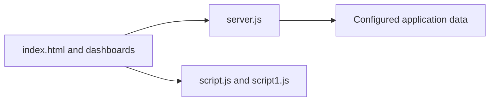

# Mess Management Prototype

## Overview

SLR is a Node.js web prototype for mess/meal management. It contains menu imagery, dashboard pages, browser scripts, and a server entry point for experimenting with meal information and user-facing views.

## Architecture



## Project structure

- `server.js` — Node.js server.
- `index.html` — entry page.
- `dashboard.html`, `dashboard1.html` — dashboard views.
- `script*.js` — browser behavior.
- `Meal1.jpeg`, `Meal2.jpg` — meal assets.

## Run locally

```bash
npm install
npm start
```

## Security

Do not commit database credentials or real user data. A production version should use environment variables, authenticated roles, validation, and audit logging.

## Status

Prototype project.

## License

No license is currently declared.
