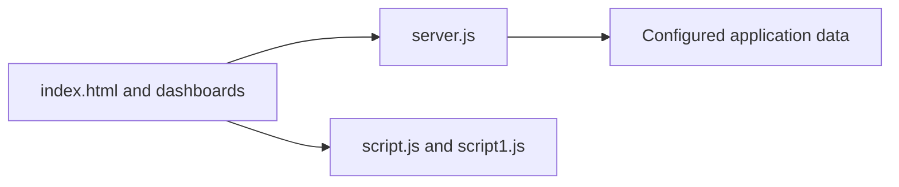

# Mess Management Prototype

## Overview

SLR is a Node.js web prototype for mess/meal management. It contains menu imagery, dashboard pages, browser scripts, and a server entry point for experimenting with meal information and user-facing views.

## Architecture



## Project structure

- `server.js` — Node.js server.
- `index.html` — entry page.
- `dashboard.html`, `dashboard1.html` — dashboard views.
- `script*.js` — browser behavior.
- `Meal1.jpeg`, `Meal2.jpg` — meal assets.

## Run locally

```bash
npm install
npm start
```

## Security

Do not commit database credentials or real user data. A production version should use environment variables, authenticated roles, validation, and audit logging.

## Status

Prototype project.

## License

No license is currently declared.

## Configuration

Copy `.env.example` to `.env` for local setup. Keep database, storage, mapping, notification, and authentication values out of Git.

## API and project docs

- [API reference](docs/API.md)
- [Contributing](CONTRIBUTING.md)
- [Security policy](SECURITY.md)
- [Changelog](CHANGELOG.md)

## Accessibility and mobile notes

The repository contains browser-facing pages intended to be tested at narrow and wide viewport sizes. Before deployment, verify keyboard navigation, visible focus states, form labels, meaningful image alternatives, readable contrast, touch-sized controls, and layouts without horizontal scrolling.

## Validation

No automated test suite is declared unless noted in `package.json`. At minimum, install dependencies, run the documented start/build/type-check commands, and manually exercise the primary page and API health route where available.
